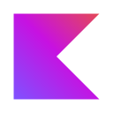

  

## About me

- 💼 Software Engineer at **[Betclic](https://betclicgroup.com/en/)**, Bordeaux, France
- ❤️‍🔥 DevOps evangelist and GitLab addict: CI/CD pipelines are my happy place
- 🏠 Self-hosting whatever I can on my homelab
- 🖨️ 3D printing whatever I can (and sometimes need 🙄), from design to print
- 🎓 Graduated from **EPITECH** (2020-2025) & **Université Laval** (2023-2024, double degree)
- 👨‍💻 Autonomous and self-taught

For more information, check out my [website](https://hervaud.fr) or my [LinkedIn](https://www.linkedin.com/in/corentin-hervaud) profile.

## 🛠️ My projects

- **[Water Me](https://waterme.hervaud.fr/)**: mobile app featuring Spiky, a virtual cactus whose watering reminders get more and more passive-aggressive (coming soon to iOS & Android)
- **[mr-title-lint](https://gitlab.com/corthx/mr-title-lint)**: GitLab CI/CD component validating merge request titles, Conventional Commits by default
- **[mr-source-branch-lint](https://gitlab.com/corthx/mr-source-branch-lint)**: GitLab CI/CD component validating merge request source branch names
- **[openapi-generator-kotlintoolchain-plugin](https://gitlab.com/corthx/openapi-generator-kotlintoolchain-plugin)**: OpenAPI Generator plugin for Kotlin Toolchain projects

## 🤝 Where I'm contributing

- **[GitLab](https://gitlab.com/gitlab-org)**: the DevSecOps platform, from code to CI/CD and deployments
- **[OpenAPI Generator](https://github.com/OpenAPITools/openapi-generator)**: generates API clients, servers and docs from OpenAPI specs
- **[Swagger Parser](https://github.com/swagger-api/swagger-parser)**: parses OpenAPI/Swagger specs into Java objects

## 🧰 Tools I work with

  
  
  
  
  <a href="https://www.gnu.org/software/bash/" target="_blank" rel="noreferrer">
    <picture>
      <source media="(prefers-color-scheme: dark)" srcset="./img/icons/bash-dark.svg" />
      
    </picture>
  </a>
  

  <a href="https://gradle.org" target="_blank" rel="noreferrer">
    <picture>
      <source media="(prefers-color-scheme: dark)" srcset="./img/icons/gradle-dark.svg" />
      
    </picture>
  </a>
  
  
  
  

  
  <a href="https://github.com" target="_blank" rel="noreferrer">
    <picture>
      <source media="(prefers-color-scheme: dark)" srcset="./img/icons/github-dark.svg" />
      
    </picture>
  </a>
  
  
  
  
  

  
  
  
  <a href="https://sentry.io" target="_blank" rel="noreferrer">
    <picture>
      <source media="(prefers-color-scheme: dark)" srcset="./img/icons/sentry-dark.svg" />
      
    </picture>
  </a>
  

  
  
  
  
  <a href="https://mise.jdx.dev" target="_blank" rel="noreferrer">
    <picture>
      <source media="(prefers-color-scheme: dark)" srcset="./img/icons/mise-dark.svg" />
      
    </picture>
  </a>
  
  

---

